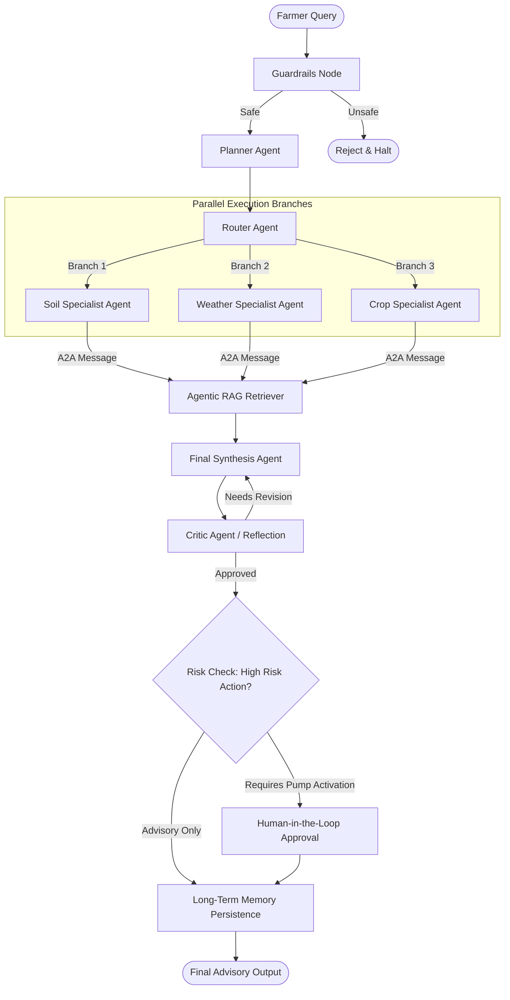

# 🌱 Smart Farm Advisor

A complete educational Agentic AI application built with **Python**, **LangGraph**, and modern Agentic Architecture concepts.

This project is built to demonstrate at the **code level** how real-world agentic patterns work together in an environmental and agricultural domain.

---

## 1. What is an Agent?

A traditional Large Language Model operates as a single stateless completion function:
```text
Question ──────────────► LLM ──────────────► Answer
```

An **Agent**, by contrast, is an autonomous system that uses an LLM as its reasoning engine within a dynamic feedback loop:
```text
Goal
  ↓
Plan
  ↓
Observe
  ↓
Use Tools / Gather Live Telemetry
  ↓
Reason & Cross-Examine
  ↓
Act / Synthesize
  ↓
Evaluate & Critique (Reflection)
  ↓
Self-Correct & Adapt
```

---

## 2. System Architecture

The following LangGraph graph coordinates the advisory pipeline for **GreenLeaf Farm**:



---

## 3. Concept → Code Mapping

Every core Agentic AI concept maps directly to a clean, readable module in the codebase:

| Agentic Concept | Implementation Location | Educational Purpose |
| :--- | :--- | :--- |
| **Central Shared State** | [`state/agent_state.py`](file:///Users/denuwanwijesinghe/Documents/BSc.%20Artficial%20Intellligence/project_learn/Agentic_ai/agri_assist/state/agent_state.py) | Blackboard pattern with reducers (`Annotated[..., merge_dicts]`) for multi-branch sync |
| **Guardrails (In & Out)** | [`safety/guardrails.py`](file:///Users/denuwanwijesinghe/Documents/BSc.%20Artficial%20Intellligence/project_learn/Agentic_ai/agri_assist/safety/guardrails.py) | Blocks prompt injection and enforces epistemic humility (no absolute disease claims) |
| **Goal Setting & Planning** | [`agents/planner.py`](file:///Users/denuwanwijesinghe/Documents/BSc.%20Artficial%20Intellligence/project_learn/Agentic_ai/agri_assist/agents/planner.py) | Translates raw questions into an explicit goal and decomposed task list |
| **Exploration / Discovery**| [`agents/planner.py`](file:///Users/denuwanwijesinghe/Documents/BSc.%20Artficial%20Intellligence/project_learn/Agentic_ai/agri_assist/agents/planner.py) | Detects information gaps (`missing_info`) before jumping to conclusions |
| **Dynamic Routing** | [`agents/router.py`](file:///Users/denuwanwijesinghe/Documents/BSc.%20Artficial%20Intellligence/project_learn/Agentic_ai/agri_assist/agents/router.py) | Hybrid heuristic + LLM routing to avoid executing unnecessary specialist agents |
| **Parallelization** | [`graph/farm_graph.py`](file:///Users/denuwanwijesinghe/Documents/BSc.%20Artficial%20Intellligence/project_learn/Agentic_ai/agri_assist/graph/farm_graph.py) | Runs Soil, Weather, and Crop agents concurrently to reduce wall-clock latency |
| **Multi-Agent Persona** | `agents/soil_agent.py`, `agents/weather_agent.py`, `agents/crop_agent.py` | Segregated responsibilities and modular domain prompts |
| **A2A Communication** | [`agents/soil_agent.py`](file:///Users/denuwanwijesinghe/Documents/BSc.%20Artficial%20Intellligence/project_learn/Agentic_ai/agri_assist/agents/soil_agent.py#L48-L58) | Standardized JSON messages (`sender`, `receiver`, `task`, `payload`) |
| **Tool Calling / Function Calling** | [`tools/farm_database.py`](file:///Users/denuwanwijesinghe/Documents/BSc.%20Artficial%20Intellligence/project_learn/Agentic_ai/agri_assist/tools/farm_database.py) | Direct querying of live moisture, pH, and weather telemetry |
| **ReAct Action Loop** | `agents/soil_agent.py`, `agents/weather_agent.py` | Observable `Action` -> `Observation` trace recording |
| **Exception Recovery** | [`tools/farm_database.py`](file:///Users/denuwanwijesinghe/Documents/BSc.%20Artficial%20Intellligence/project_learn/Agentic_ai/agri_assist/tools/farm_database.py#L52-L68) | Simulates transient 503 API timeout and falls back to cached satellite data |
| **Agentic RAG** | [`rag/knowledge_base.py`](file:///Users/denuwanwijesinghe/Documents/BSc.%20Artficial%20Intellligence/project_learn/Agentic_ai/agri_assist/rag/knowledge_base.py), [`rag/retriever.py`](file:///Users/denuwanwijesinghe/Documents/BSc.%20Artficial%20Intellligence/project_learn/Agentic_ai/agri_assist/rag/retriever.py) | Retrieves external agricultural documentation to ground decisions |
| **Prompt Chaining** | [`agents/final_agent.py`](file:///Users/denuwanwijesinghe/Documents/BSc.%20Artficial%20Intellligence/project_learn/Agentic_ai/agri_assist/agents/final_agent.py#L38-L60) | Stage-by-stage pipelines passing outputs from specialist nodes to synthesis |
| **Prioritization** | [`agents/final_agent.py`](file:///Users/denuwanwijesinghe/Documents/BSc.%20Artficial%20Intellligence/project_learn/Agentic_ai/agri_assist/agents/final_agent.py#L60-L75) | Distinguishes detection from ranking (Priority 1: Water deficit > Heat > Disease) |
| **Reflection / Self-Correction**| [`agents/critic_agent.py`](file:///Users/denuwanwijesinghe/Documents/BSc.%20Artficial%20Intellligence/project_learn/Agentic_ai/agri_assist/agents/critic_agent.py) | Critic audits draft; LangGraph conditional edge routes back for revision |
| **Human-in-the-Loop (HITL)** | [`app.py`](file:///Users/denuwanwijesinghe/Documents/BSc.%20Artficial%20Intellligence/project_learn/Agentic_ai/agri_assist/app.py#L220-L235) | Gating physical actuators (irrigation pumps) requiring user confirmation |
| **Short-Term Memory** | [`memory/short_term.py`](file:///Users/denuwanwijesinghe/Documents/BSc.%20Artficial%20Intellligence/project_learn/Agentic_ai/agri_assist/memory/short_term.py) | Session-level conversation history tracking |
| **Long-Term Memory** | [`memory/long_term.py`](file:///Users/denuwanwijesinghe/Documents/BSc.%20Artficial%20Intellligence/project_learn/Agentic_ai/agri_assist/memory/long_term.py) | SQLite database tracking prior farm issues and farmer feedback across restarts |
| **Learning / Adaptation** | [`memory/long_term.py`](file:///Users/denuwanwijesinghe/Documents/BSc.%20Artficial%20Intellligence/project_learn/Agentic_ai/agri_assist/memory/long_term.py#L55-L67) | Historical feedback informs future recommendations without model retraining |
| **Resource-Aware Model Router** | [`config.py`](file:///Users/denuwanwijesinghe/Documents/BSc.%20Artficial%20Intellligence/project_learn/Agentic_ai/agri_assist/config.py#L120-L145) | Directs simple tasks to Flash (low cost) and complex tasks to Pro (deep reasoning) |
| **Monitoring & Telemetry** | [`safety/monitoring.py`](file:///Users/denuwanwijesinghe/Documents/BSc.%20Artficial%20Intellligence/project_learn/Agentic_ai/agri_assist/safety/monitoring.py) | Real-time logger tracking step durations, status, models, and errors |
| **Evaluation Suite** | [`evaluation/evaluator.py`](file:///Users/denuwanwijesinghe/Documents/BSc.%20Artficial%20Intellligence/project_learn/Agentic_ai/agri_assist/evaluation/evaluator.py) | Quantifies guardrail pass rates and routing accuracy against test cases |
| **Model Context Protocol (MCP)**| [`tools/mcp_demo.py`](file:///Users/denuwanwijesinghe/Documents/BSc.%20Artficial%20Intellligence/project_learn/Agentic_ai/agri_assist/tools/mcp_demo.py) | Demonstrates standard open protocol for tools vs simple function calling |

---

## 4. Key Conceptual Distinctions Explained

### 1. Workflow vs Agent
* **Workflow:** A hardcoded, deterministic sequence of steps ($A \rightarrow B \rightarrow C$). It lacks dynamic branches or autonomous evaluation.
* **Agent:** An autonomous entity that observes environment state, sets goals, determines dynamic next steps, uses tools, and self-corrects based on feedback.

### 2. RAG vs Tool Use
* **RAG:** Ingests external reference documentation (e.g. agricultural textbooks, university extension articles) to ground the LLM's conceptual understanding.
* **Tool Use:** Interacts dynamically with external environments, services, or actuators (e.g. reading live soil sensors, requesting live weather, triggering an irrigation valve).

### 3. Memory vs RAG
* **Memory:** Information about the current user, conversational context, or historical past interactions (e.g. GreenLeaf Farm's past intervention outcomes).
* **RAG:** Static or dynamic domain literature, documentation, and external reference corpora.

### 4. Planning vs Prompt Chaining
* **Prompt Chaining:** The developer hardcodes the sequential flow of prompts in code.
* **Planning:** The LLM inspects the problem dynamically and generates an adaptive plan composed of tasks to achieve the goal.

### 5. Multi-Agent vs Parallelization
* **Parallelization:** Executing independent computational tasks simultaneously to reduce wall-clock time.
* **Multi-Agent:** Assigning different personas, objectives, and domain boundaries to separate agents (e.g. Soil Specialist vs Weather Specialist vs Critic).
* *Note:* In this project, multi-agent specialists are executed in parallel via LangGraph branches.

### 6. Reflection vs Evaluation
* **Reflection (Self-Correction):** The agent audits and revises its *own* generated draft within an active execution cycle before finalizing the output.
* **Evaluation:** An external, offline benchmark test suite that runs multiple test cases to measure overall system accuracy, safety pass rates, and performance.

### 7. MCP vs Tool Calling
* **Tool Calling:** A model-specific capability where an LLM emits a function name and arguments in JSON.
* **MCP (Model Context Protocol):** An open standard client-server protocol enabling applications and devices to universally advertise and expose tools and resources across different AI clients.

---

## 5. Concept Deep-Dives & Code Walkthroughs

### Concept: Goal Setting & Planning
* **What is it?** Converting ambiguous natural language into an explicit objective and an ordered list of tasks.
* **Why do we need it?** Direct answers on complex problems hallucinate or skip crucial diagnostic steps.
* **Where is it?** [`agents/planner.py`](file:///Users/denuwanwijesinghe/Documents/BSc.%20Artficial%20Intellligence/project_learn/Agentic_ai/agri_assist/agents/planner.py)
* **Code:**
```python
def planner_node(state: FarmState) -> FarmState:
    llm = select_model(task_complexity="complex")
    prompt = f"Create a structured plan in JSON for query: '{state['user_query']}'"
    # Returns goal, plan steps, and missing info
```

### Concept: Parallelization & Multi-Agent Collaboration
* **What is it?** Running multiple specialized agents concurrently and merging their outputs into a unified state.
* **Why do we need it?** If each agent takes 1.5 seconds, running 3 agents sequentially takes 4.5s. Parallel execution completes in $\max(1.5s, 1.5s, 1.5s) \approx 1.5s$.
* **Where is it?** [`graph/farm_graph.py`](file:///Users/denuwanwijesinghe/Documents/BSc.%20Artficial%20Intellligence/project_learn/Agentic_ai/agri_assist/graph/farm_graph.py) and [`state/agent_state.py`](file:///Users/denuwanwijesinghe/Documents/BSc.%20Artficial%20Intellligence/project_learn/Agentic_ai/agri_assist/state/agent_state.py)
* **Code:**
```python
# In state/agent_state.py:
specialist_results: Annotated[Dict[str, str], merge_dicts]

# In graph/farm_graph.py:
builder.add_conditional_edges("router", dynamic_router_target, [
    "soil_agent", "weather_agent", "crop_agent"
])
builder.add_edge("soil_agent", "rag")
builder.add_edge("weather_agent", "rag")
builder.add_edge("crop_agent", "rag")
```

### Concept: Reflection & Self-Correction
* **What is it?** A secondary agent evaluating the draft against safety rules, telemetry, and evidence.
* **Why do we need it?** Catches dangerous errors (such as recommending watering tomatoes during the blistering 34°C midday heat, which scorches leaves).
* **Where is it?** [`agents/critic_agent.py`](file:///Users/denuwanwijesinghe/Documents/BSc.%20Artficial%20Intellligence/project_learn/Agentic_ai/agri_assist/agents/critic_agent.py)
* **Code:**
```python
def critic_evaluation(state: FarmState) -> Literal["final_agent", "end"]:
    if state.get("confidence", 0.8) < 0.80 and state.get("revision_count", 0) < 2:
        return "final_agent"  # Route back to revise!
    return "end"
```

---

## 6. How to Run

### Installation
```bash
# 1. Create and activate a virtual environment
python3 -m venv .venv
source .venv/bin/activate

# 2. Install dependencies
pip install -r requirements.txt

# 3. (Optional) Set your Gemini API key in .env
cp .env.example .env
# If no key is set, the system seamlessly runs in educational Mock Mode!
```

### 1. Educational Learning Mode (`--learn`)
Walk through every concept step-by-step with state inspection:
```bash
python app.py --learn
```

### 2. Standard Interactive Mode
Chat directly with the Smart Farm Advisor:
```bash
python app.py
```

### 3. Evaluation Mode (`--eval`)
Run quantitative sanity tests on routing and safety:
```bash
python app.py --eval
```

### 4. MCP Demonstration (`--mcp`)
Run the Model Context Protocol conceptual server demo:
```bash
python app.py --mcp
```
